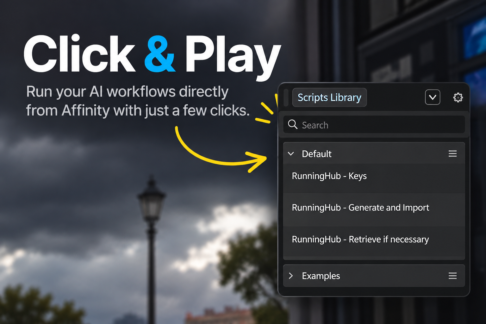
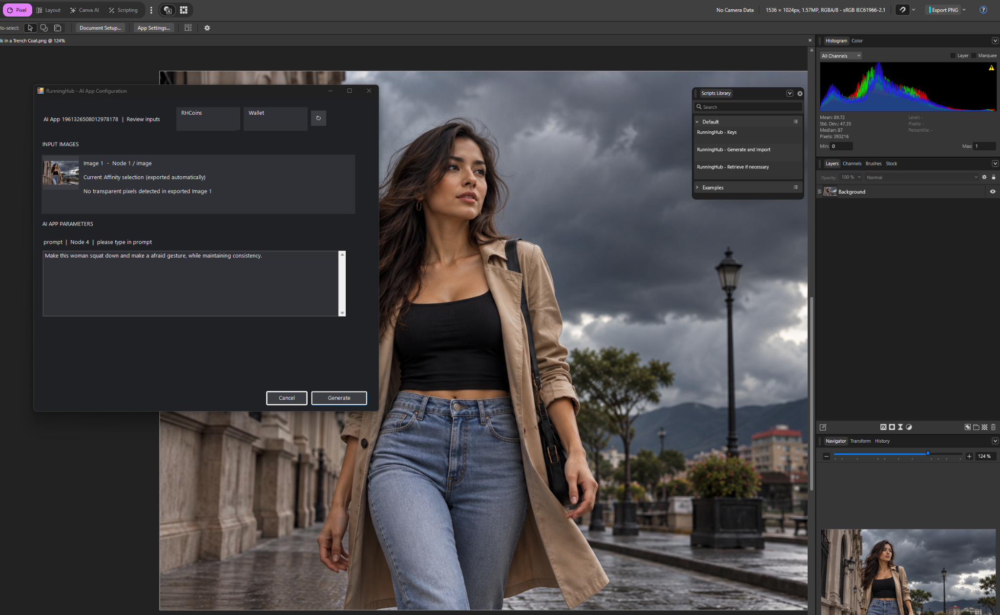
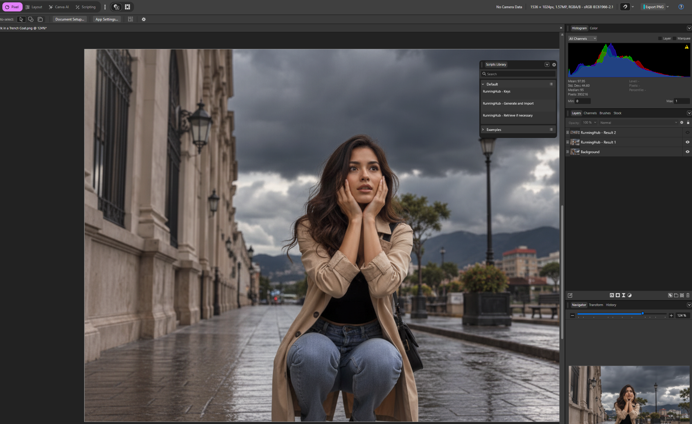

# RunningHub for Affinity v1.0.0

**Connect Affinity to RunningHub and bring AI-powered image processing into your creative workflow.**

## About the Project

RunningHub for Affinity is a free, open-source integration designed to connect Affinity by Canva with RunningHub's cloud-based AI tools and workflows.
I developed this project from scratch with the assistance of ChatGPT, motivated by the need to expand the capabilities of the free version of Affinity by Canva through integration with third-party AI services, starting with RunningHub.ai.
My vision is to continue developing this project by expanding its compatibility with locally hosted ComfyUI, bringing support to Affinity on macOS, and eventually extending the integration to other creative applications, including GIMP and Krita on Windows and Linux.
**RunningHub for Affinity is completely free to use.** If you find this project valuable and would like to support its continued development, you are welcome to make a voluntary donation of any amount. Your support will help sustain this project and encourage the creation of future open-source tools.

**[Support this project via PayPal](https://paypal.me/carbarmo)**

## Features

- Send document images or selections from Affinity to RunningHub.
- Support different input modes: Whole Document, Selection Area, and Selection Only.
- Run compatible AI Apps and ComfyUI workflows through RunningHub.
- Retrieve generated results and import them into Affinity as layers.
- Preserve image dimensions without automatic resizing by the integration.
- Configure RunningHub API access locally.

## Click & Play

Run your AI workflows directly from Affinity with just a few clicks.

Access RunningHub.ai from Affinity's Scripts Library.
Configure your AI App, generate images, and retrieve
the results as new layers — without writing code.

## Screenshots

### Generate — Send an Image to RunningHub.ai

Configure an AI App, automatically export the selected
Affinity content, and send it to RunningHub.ai for processing.

### Retrieve — Import Results as Affinity Layers

Retrieve generated images from RunningHub.ai and import
them directly into your Affinity document as new layers.

### Windows Installer (Recommended)

**[Download Windows Installer (.exe)](../../releases/download/v1.0.0/RunningHub-for-Affinity-v1.0.0-Automatic.zip)**

The easiest way to get started. Download the installer, run it, and follow the setup instructions.

- No Python installation required.
- Automatic installation of the connector.

[Windows Installation Guide](INSTALL-WINDOWS.md)

### Manual Installation (Python)

**[Download Manual Installation Package (.zip)](../../releases/download/v1.0.0/RunningHub-for-Affinity-v1.0.0-Manual.zip)**

For users who prefer to install and run the connector manually.

- Requires Python 3.12 (recommended).
- Includes the necessary connector files.

[Manual Installation Guide](INSTALL-MANUAL.md)

### Compatibility

Currently tested on:

- Windows 11
- Affinity 3.3.1 (Build 4940)
- Python 3.12

Other platforms and versions have not yet been verified.

### Need Help?

See the [Troubleshooting Guide](TROUBLESHOOTING.md) for common issues and recovery instructions.

**Important:** RunningHub for Affinity is free and open-source software licensed under GPL-3.0-only. RunningHub cloud processing may require paid credits.

## How It Works

1. Select an image layer in Affinity layers.
2. Choose a compatible RunningHub workflow or API.
3. Submit the input and processing parameters.
4. Run the workflow in the cloud.
5. Retrieve the output and import it into Affinity.

You can use an API or workflow that requires one, two, three or more IMAGES for processing. Just select the layer of IMAGE 1 and run the respective script, it will ask you for the layers of the next IMAGES.
In case you require a manual mask of he IMAGE for the API you can do a mask in Affinity and select the layer where the IMAGE and mask are.

## Installation

RunningHub for Affinity v1.0.0 is available for Windows with two installation methods:

### Automatic Installation (Recommended)

Use the Windows installer for a simplified setup.

1. Visit the [GitHub Releases](https://github.com/carbarmo-ai/RunningHub-for-Affinity-v1.0.0/releases/tag/v1.0.0) page.
2. Download `RunningHub-for-Affinity-v1.0.0-Automatic.zip`.
3. Extract the ZIP file and follow the included installation instructions.

For detailed setup instructions, see [Automatic Installation Guide](INSTALL-WINDOWS.md).

### Manual Installation

For users who prefer to set up the connector manually using Python.

1. Visit the [GitHub Releases](https://github.com/carbarmo-ai/RunningHub-for-Affinity-v1.0.0/releases/tag/v1.0.0) page.
2. Download `RunningHub-for-Affinity-v1.0.0-Manual.zip`.
3. Extract the ZIP file and follow the included instructions.

For detailed setup instructions, see [Manual Installation Guide](INSTALL-MANUAL.md).

### Temporary Files and Disk Space

Both installation methods use the same `Exchange` folder:

`%LOCALAPPDATA%\RunningHubForAffinity\Exchange`

This folder stores temporary image exports, previews, and downloaded processing results exchanged between Affinity and the connector.

Temporary files may accumulate over time and consume disk space. Once all processing tasks are complete, pending results have been retrieved, and important work has been saved, you can remove unnecessary temporary contents to free up storage.

**Important:** Close Affinity and stop the connector before cleaning the folder. Keep the `Exchange` folder itself in place. Deleting files required by unfinished tasks or pending result recovery may cause data loss.

For detailed cleanup instructions, see the [Troubleshooting Guide](TROUBLESHOOTING.md).

**Future improvement:** Automatic temporary-file management is being evaluated to help reduce unnecessary disk usage in future releases. This functionality is not yet available in v1.0.0.

## Requirements

- Affinity by Canva with scripting support.
- A RunningHub account and API access.
- Internet connectivity.
- A compatible RunningHub AI App or workflow.

## Security

API credentials and local configuration must remain on the user's computer. Never commit API keys, access tokens, or personal configuration files to this repository.

## Project Status

**In development.**

The integration has been tested with RunningHub API task creation, cloud execution, and result retrieval. Installation and distribution workflows are being prepared.

## Disclaimer

This is an independent community project and is not officially affiliated with, endorsed by, or maintained by Canva, Affinity, or RunningHub.
